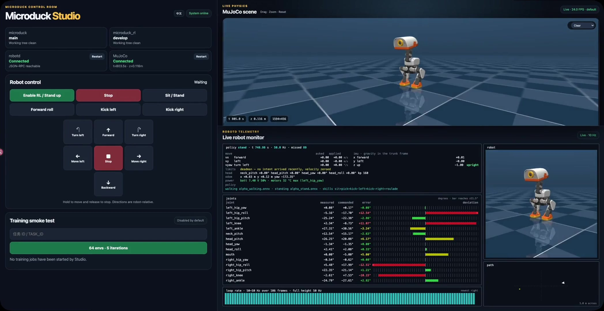

<p align="center">
  
</p>

<h1 align="center">Microduck Studio</h1>

<p align="center">一个用于开发、仿真和验证 Microduck 的本地控制台。</p>

<p align="center">
  <a href="README.md">English</a> · <a href="README.zh-CN.md">简体中文</a>
</p>

<p align="center">
  
  
  
  <a href="LICENSE"></a>
</p>

<p align="center">
  支持 AI Coding：
  <a href="https://developers.openai.com/codex/">Codex</a> ·
  <a href="https://code.claude.com/docs/en/overview">Claude Code</a> ·
  <a href="https://cursor.com/docs/agent/overview">Cursor Agent</a> ·
  <a href="https://docs.github.com/en/copilot/concepts/agents/copilot-cli/about-copilot-cli">GitHub Copilot CLI</a>
</p>

<p align="center">
  <a href="#使用-ai-coding-工具启动">AI 启动</a> ·
  <a href="#快速开始">快速开始</a> ·
  <a href="#robotctl-monitor">终端监控</a> ·
  <a href="#三个项目如何协作">项目架构</a> ·
  <a href="#页面无法控制机器人时">故障排查</a>
</p>

Microduck Studio 是 Microduck 的本地网页控制台，可在浏览器中操作仿真机器人、查看
MuJoCo 实时画面与运行状态，并管理开发服务。

## 使用 AI Coding 工具启动

使用能访问本机项目和终端的 AI Coding 工具打开 `microduck-dev` 工作区，然后输入：

```text
帮我启动 Microduck Studio 的所有服务。检查三个同级仓库、Docker、uv，以及 7801 和 8090
端口；然后进入 microduck-studio 运行 ./scripts/dev-stack.sh。等待出现“contract probe passed”
后，报告网页地址及各服务状态。不要启动训练任务，也不要切换兄弟仓库的分支。
```

## 快速开始

### 环境要求

- Docker（含 Docker Compose）
- `git`、`curl`、Python 3 和 [`uv`](https://docs.astral.sh/uv/)
- macOS 使用默认 native 模式；Linux 使用 Docker 模式

### 1. 下载三个仓库

三个仓库放在同一个工作区的同级目录：

```text
microduck-dev/
├── microduck/
├── microduck_rl/
└── microduck-studio/
```

```bash
mkdir -p ~/microduck-dev
cd ~/microduck-dev

git clone https://github.com/microai-lab/microduck.git
git clone --branch develop https://github.com/microai-lab/microduck_rl.git
git clone https://github.com/microai-lab/microduck-studio.git
```

已有仓库可以直接使用，请确认 `microduck` 的 `main` 和 RL Fork 的 `develop` 已更新。
启动器不会自动切换兄弟仓库的工作分支。

### 2. 准备仿真环境

macOS native 模式需要安装 RL 环境及网页渲染依赖：

```bash
cd ~/microduck-dev/microduck_rl
uv sync --extra visualization
```

Docker 模式由镜像安装 MuJoCo 运行依赖，无需另建宿主机 RL 虚拟环境。
首次启动会下载官方策略集，已有完整缓存时可以离线复用。当前使用官方 v8 `velstand` 策略。

### 3. 启动服务

macOS 默认在后台运行 MuJoCo，不弹出桌面 Viewer；`robotd`、`tofd` 与 Studio 运行在 Docker 中：

```bash
cd ~/microduck-dev/microduck-studio
./scripts/dev-stack.sh
```

Linux 或需要全 Docker 环境时使用：

```bash
./scripts/dev-stack.sh --sim-mode docker --gpu none
```

出现 `contract probe passed` 后，打开 **http://127.0.0.1:8090**。
启动器会检查各服务及仿真控制链路；只看到网页并不代表机器人控制已经就绪。

## 主要能力

| 功能 | 可以做什么 |
|---|---|
| 机器人控制 | 前进、后退、左右移动和转向，启用/停止 RL，执行坐下、站起、前滚翻和踢球。 |
| MuJoCo 实时画面 | 在浏览器查看仿真场景，在世界视角与机器人头部第一视角之间切换。 |
| 相机操作 | 拖动旋转、滚轮或触控板缩放、双击恢复默认视角。 |
| 画质选择 | 切换流畅、清晰和无损档位，最高请求 1920×1080 画面，显示实际 FPS。 |
| 场景切换 | 从当前 RL 仓库中选择场景并应用，自动重启仿真与机器人服务。 |
| 实时监视器 | 查看策略、控制指令、关节状态、IMU、8×8 ToF、里程计、安全状态与控制循环频率。 |
| 服务管理 | 查看连接状态，在网页启动或重启 MuJoCo 和 `robotd`。 |
| 中英文切换 | 页面可切换简体中文与英文。 |
| 多种运行方式 | macOS 原生后台渲染、全 Docker CPU 渲染，以及 Linux GPU 启动选项。 |

移动方向以鸭子自身朝向为准。松开控件、隐藏页面或连接断开时会请求停止。
侧移效果仍取决于策略，可能出现停滞或偏航，不保证直线侧移。

## 日常使用

以下命令都在 `microduck-studio` 中运行：

| 目的 | 命令 |
|---|---|
| 启动或重新启动整套服务 | `./scripts/dev-stack.sh` |
| 检查服务状态 | `./scripts/dev-stack.sh status` |
| 停止整套服务 | `./scripts/dev-stack.sh stop` |
| 打开终端实时监控 | `./scripts/dev-stack.sh monitor` |
| 使用指定场景 | `./scripts/dev-stack.sh --scene scene_vslam.xml` |
| 使用 BAM 回差执行器仿真 | `./scripts/dev-stack.sh --actuator-model bam --scene scene_velstand.xml` |
| 打开桌面 MuJoCo Viewer | `./scripts/dev-stack.sh --viewer` |
| 最后一个页面关闭 10 秒后停止 MuJoCo | `./scripts/dev-stack.sh --stop-on-browser-close` |
| 跳过启动时的仿真移动探针 | `./scripts/dev-stack.sh --skip-control-probe` |

BAM 是可选的执行器仿真方式，配合 `scene_velstand.xml` 使用；默认仍使用 XML 执行器。

默认后台模式需要通过 `stop` 命令关闭。macOS native 模式可加 `--stop-on-browser-close`：
最后一个场景页面断开 10 秒后停止 MuJoCo，期间刷新或重连会取消退出。
`--headless` 可显式选择后台运行；`--viewer` 会打开桌面窗口，关闭窗口也会停止 MuJoCo。

### 如何选择渲染模式

| 场景 | 命令 | 使用说明 |
|---|---|---|
| macOS 本地开发 | `./scripts/dev-stack.sh` | 使用本机渲染，MuJoCo 在后台运行。 |
| macOS Docker Desktop 或无 GPU 环境 | `./scripts/dev-stack.sh --sim-mode docker --gpu none` | 全部运行在 Docker，CPU 渲染可能较慢。 |
| Linux DRI GPU | `./scripts/dev-stack.sh --sim-mode docker --gpu dri` | 使用主机 `/dev/dri` 设备，需具备相应 GPU 和驱动。 |
| Linux NVIDIA GPU | `./scripts/dev-stack.sh --sim-mode docker --gpu nvidia` | 需安装 NVIDIA 驱动及 NVIDIA Container Toolkit。 |

GPU 类型通过 `--gpu` 显式选择，必须搭配 `--sim-mode docker`。
macOS Docker Desktop 无法使用上述 Linux GPU 透传方式。实际帧率取决于硬件、场景和画质。

### 网页工作台说明

- **MuJoCo 场景**：查看世界或第一视角画面，选择场景、调整相机与画质。
- **ROBOTD TELEMETRY**：查看机器人状态、传感器数据、关节目标与误差以及运动轨迹。
- **控制与服务卡片**：操作机器人，查看各服务连接状态，点击启动或重启。

重启 MuJoCo 时会连带重启 `robotd`。如果网页服务本身已停止，请从终端执行启动命令。

### MuJoCo 场景目录

在下拉框中选择场景，点击**应用**后生效。点击选择框前的**场景**可复制当前场景文件名。
可选条目取决于本地 RL 仓库包含的场景。

| 文件 | 用途 |
|---|---|
| `scene.xml` | 默认平地场景。 |
| `scene_allcollisions.xml` | 全身碰撞与接触检查。 |
| `scene_apartment.xml` | 带家具的公寓环境。 |
| `scene_backlash.xml` | 关节回差仿真。 |
| `scene_ball.xml` | 足球与踢球交互。 |
| `scene_rollers.xml` | 脚部滚轮仿真。 |
| `scene_vslam.xml` | 带地标的视觉定位环境。 |
| `scene_walk.xml` | 行走机器人模型。 |
| `scene_walk_backlash.xml` | 带关节回差的行走模型。 |
| `scene_velstand.xml` | 配合 BAM 使用的全身碰撞与回差场景。 |

### 画质与语言

使用页面顶部的语言按钮切换中文或英文。在世界视角中选择画质：

| 档位 | 画面上限 | 使用建议 |
|---|---:|---|
| 流畅 | 960×540 | 优先降低带宽和延迟。 |
| 清晰（默认） | 1920×1080 | 常规桌面观看。 |
| 无损 | 1920×1080 | 适合静态细节检查，帧率可能降低。 |

画面会按显示区域与屏幕像素倍率调整大小。FPS 显示实际收到并显示的帧率，24 FPS 是请求目标，
不代表固定输出帧率。网页与本机仿真使用同一场景状态。

## `robotctl monitor`

在终端查看实时监控：

```bash
./scripts/dev-stack.sh monitor
```

| 按键 | 动作 |
|---|---|
| `q`、`Esc` 或 `Ctrl-C` | 退出 |
| `[` / `]` 或 `Left` / `Right` | 旋转三维机器人视角 |
| `d` | 显示或隐藏三维机器人视图 |

三维视图要求终端至少 110 列宽；较窄的终端仍可显示状态和关节表格。

## 三个项目如何协作

- **microduck**：机器人运行时、策略执行与安全控制。
- **microduck_rl**：MuJoCo 仿真、模型及训练工具。
- **microduck-studio**：网页控制台和服务启动管理。

## 故障排查

### 诊断命令

```bash
docker compose ps
docker compose logs -f studio robotd tofd
```

### 常见启动和显示问题

| 现象 | 检查与恢复方式 |
|---|---|
| 一直等待 MuJoCo 画面 | 执行 `./scripts/dev-stack.sh status`；网页在线时尝试 MuJoCo 卡片的启动/重启，否则从终端重新启动。 |
| Docker 模式画面较卡 | macOS 使用默认 native 模式，或把画质切换为**流畅**；Linux 可按硬件条件选择 GPU 参数。 |
| 意外出现桌面 Viewer | 停止服务后使用默认启动命令，去掉 `--viewer`。 |
| 网页启动/重启按钮不可用 | 从终端运行 `./scripts/dev-stack.sh`，恢复服务管理功能。 |
| 提示缺少 Pillow | 在 RL 仓库执行 `uv sync --extra visualization`，再重新启动。 |

### 页面无法控制机器人时

1. 执行 `./scripts/dev-stack.sh status`，确认服务在线。
2. 确认机器人与仿真器已连接，点击**启用 RL**。
3. 查看 `docker compose logs -f studio robotd` 的报错。
4. 重新运行默认启动命令，等待 `contract probe passed`。

### 分别运行组件

仅运行桌面 MuJoCo Viewer：

```bash
./scripts/dev-stack.sh stop
cd ../microduck_rl
uv run --extra visualization mjpython -m mjlab_microduck.sim.body_server --keyframe HOME --port 7801 --render
```

仅运行 Studio 网页：

```bash
uv sync --extra dev
cp .env.example .env
uv run microduck-studio
```

这只启动网页，机器人和仿真服务需要单独运行。

## 训练冒烟测试

训练任务默认关闭。在宿主机上直接运行 Studio 时，可启用 64 环境、5 次迭代的训练冒烟测试：

```bash
MICRODUCK_STUDIO_ENABLE_JOBS=true uv run microduck-studio
```

## 开发

```bash
uv sync --extra dev
uv run pytest
uv run ruff check .
uv run ruff format --check .
node --test tests/test_frontend.mjs
```

## 安全

网页没有身份验证，应仅在本机或可信网络中使用。机器人动作与安全限制由 `robotd` 执行。

## 许可证

[MIT](LICENSE)
